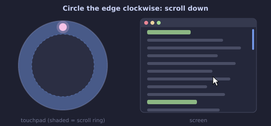

# circular-scroll

Ring-style **circular scrolling** for round touchpads on Linux — like the
"wheel pad" on Panasonic Let's Note laptops — on **Wayland** (Hyprland, Sway,
GNOME, KDE…) and X11.

<p align="center"></p>

The old X11 Synaptics driver had circular scrolling built in, but libinput
(which every modern desktop uses) does not. This small daemon adds it back. Failover by design, if the daemon stops for any reason, the touchpad is released and allows normal operation.

## How it works

- Start a touch **near the edge** of the touchpad and move around the ring:
  clockwise scrolls down, anticlockwise scrolls up, until you lift your finger.
- Touches that start anywhere else behave exactly as before — pointer movement,
  tap-to-click, two-finger scroll and gestures are untouched.

Under the hood it grabs the touchpad, passes normal touches through to a
virtual copy of the touchpad (so libinput still handles them), and turns ring
touches into mouse-wheel events.

## Known working laptops

| Laptop | Touchpad | Distro / desktop | Status |
|---|---|---|---|
| Panasonic Let's Note CF-SX4 | Synaptics PS/2 (round) | CachyOS + Hyprland | ✅ Works out of the box |
| Panasonic Let's Note CF-S10 | Synaptics PS/2 (round) | CachyOS + Hyprland | ✅ Works out of the box |

It should work with any touchpad, round or not. Tried it on another laptop?
[Open an issue](https://github.com/wagidevnull/circular-scroll/issues/new) with
your model, the touchpad name from `sudo circular-scroll --list`, your distro and
desktop, and whether it worked out of the box — it'll be added to the list.

## Install

Requires systemd and Python 3.11+.

```sh
git clone https://github.com/wagidevnull/circular-scroll.git
cd circular-scroll
./install.sh
```

The installer will:

1. install `python-evdev` with your package manager (pacman, apt, dnf or zypper),
2. install the daemon and a systemd service,
3. walk you through a 15-second calibration: trace around the very edge of the
   touchpad so it learns where the edge of your pad really is,
4. start the service and enable it at boot.

## Settings

Edit `/etc/circular-scroll.toml`, then `sudo systemctl restart circular-scroll`.

| Setting | Default | Meaning |
|---|---|---|
| `ring_start` | `0.70` | How far out a touch must start to scroll (fraction of the radius). Lower = wider ring. |
| `degrees_per_notch` | `20.0` | Rotation per scroll step. Lower = faster scrolling. |
| `reverse` | `false` | `true` makes clockwise scroll up. |
| `device_name` | auto | Exact touchpad name, if auto-detection picks the wrong device. See `sudo circular-scroll --list`. |
| `center_x/y`, `radius_x/y` | calibrated | Pad geometry in raw touchpad units. |

## Commands

```sh
./install.sh --recalibrate          # redo calibration
./install.sh --uninstall            # remove everything
sudo systemctl stop circular-scroll # pause (touchpad goes back to normal)
journalctl -u circular-scroll -f    # logs
sudo systemctl stop circular-scroll && sudo circular-scroll --debug   # verbose
```

## Notes

- The real touchpad is replaced by a virtual one named
  `<your touchpad> (circular-scroll)`. If your compositor config has
  per-device touchpad settings, point them at the new name.
- If the daemon stops for any reason, the real touchpad is released and works
  normally again.

## License

MIT — see [LICENSE](LICENSE).

## Star History

<a href="https://www.star-history.com/?repos=wagidevnull%2Fcircular-scroll&type=date&legend=top-left">
 <picture>
   <source media="(prefers-color-scheme: dark)" srcset="https://api.star-history.com/chart?repos=wagidevnull/circular-scroll&type=date&theme=dark&legend=top-left" />
   <source media="(prefers-color-scheme: light)" srcset="https://api.star-history.com/chart?repos=wagidevnull/circular-scroll&type=date&legend=top-left" />
   
 </picture>
</a>
